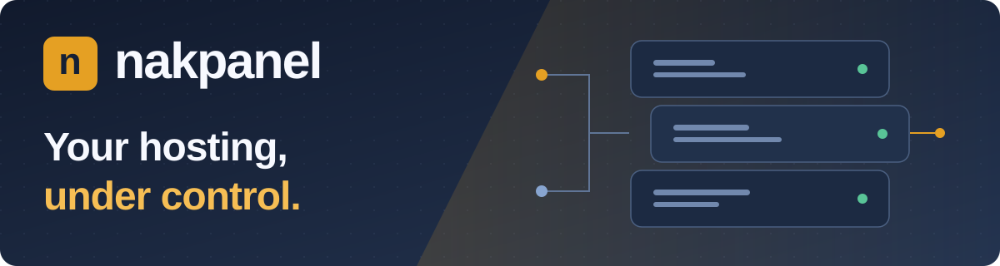
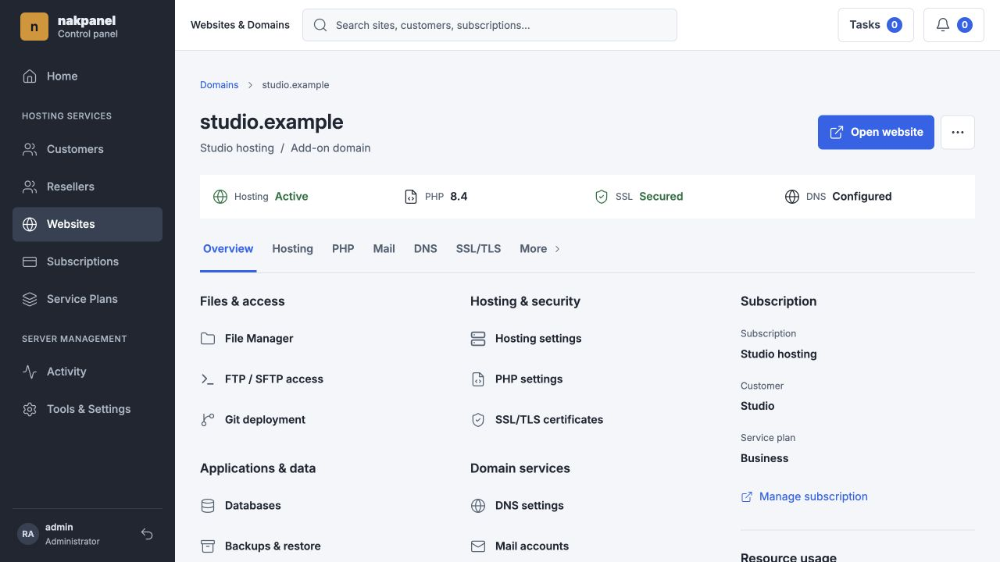
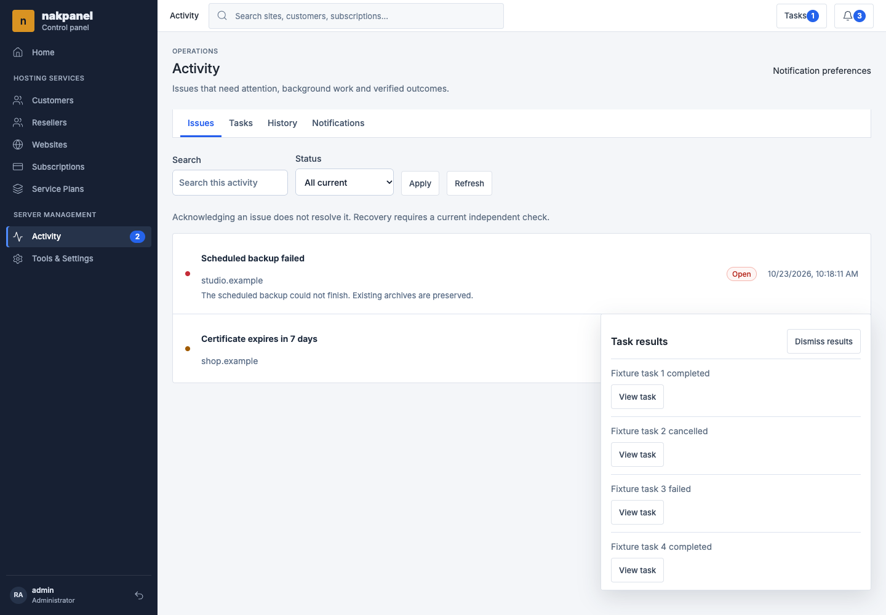
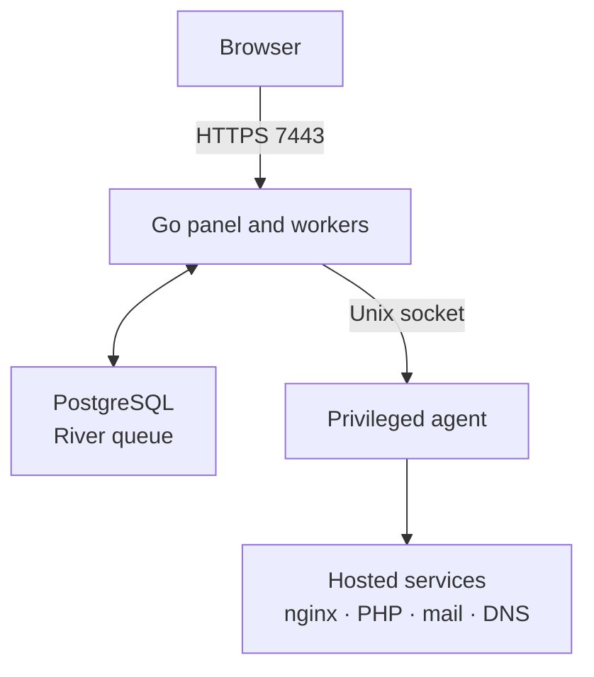

# Nakpanel



<p align="center">
  <a href="https://github.com/Smartqix/nakpanel/actions/workflows/ci.yml"></a>
  
  
  
</p>

**A Go-based hosting control panel for websites, mail, DNS, databases and verified
recovery on Ubuntu 26.04.** Manage the services behind your sites, the customers
who own them and the work happening in the background from one interface.

<p align="center">
  <a href="#server-installation">Install</a> ·
  <a href="docs/FEATURES.md">Explore features</a> ·
  <a href="#quick-start">Develop</a> ·
  <a href="docs/RECOVERY.md">Recovery guide</a> ·
  <a href="CONTRIBUTING.md">Contribute</a>
</p>

> **In active development.** Ubuntu 26.04 is the only supported server OS.
> Release qualification is still experimental; the project does not yet claim
> production readiness or complete Plesk/cPanel parity.

## A closer look



*Your website's hosting, PHP, mail, DNS and recovery tools share one workspace.
This preview uses fictional demonstration data rendered by Nakpanel's templates.*

<details>
<summary><strong>See the Operations Center</strong> — issues, tasks and personal notifications</summary>



*Keep the original failure, inspect the work and verify recovery. Opening a
notification marks it read for you; acknowledgement and resolution stay separate.*

</details>

## Why Nakpanel

- **Keep the control plane reachable.** The panel serves HTTPS on `7443`,
  independently of tenant nginx on `80` and `443`. A broken tenant vhost does
  not take away that separate route to the panel.
- **See what actually happened.** The Operations Center keeps Issues, Tasks,
  History and a personal Notifications inbox together. Failed attempts remain
  visible after retries, and an independent check must verify issue recovery.
- **Choose the right PHP runtime.** Host PHP 8.3, 8.4 and 8.5 with required
  extensions, isolated FPM/CLI execution and readiness checks. Classic PHP and
  Git-backed Managed PHP support different application workflows.
- **Work within clear ownership.** Customer records, subscriptions, plans,
  quotas and current role checks keep hosting work tied to its owning resources.
  Review destructive actions and preserve unrelated resources.

## What you can manage

| Workspace | Capabilities |
| --- | --- |
| **Websites & applications** | Domains and subdomains, Classic/Managed PHP, WordPress Toolkit, Git, files, logs, statistics, rootless OCI containers and subscription Valkey. |
| **Mail & DNS** | Mailboxes, aliases, webmail, DKIM/DMARC, Maildir/IMAP import and provider DNS templates with preview/apply. |
| **Customers & plans** | Customer and reseller records, subscriptions, entitlements, plan revisions, synchronization previews and compliance. |
| **Backups & recovery** | Website recovery points, scheduled server backups, encrypted disaster-recovery archives and operator recovery tools. |
| **Operations & notifications** | Scoped Issues, Tasks and History, personal read receipts, direct settings links and bounded opt-in notification email. |
| **Security & access** | Role-aware sessions, TLS, a peer-credential-checked agent, confined file access and tenant isolation controls. |

Explore the [feature guide](docs/FEATURES.md),
[Operations Center](docs/operations-center.md), [Mail](docs/MAIL.md) and
[Domain removal and preserved data](docs/DOMAIN_REMOVAL.md).

**Current boundaries:** no native Node.js/Python application hosting, billing
invoices or complete advanced reseller hierarchy. WordPress Toolkit cloning,
multisite orchestration and automatic-update policies are not implemented.
Advanced OCI workloads have their own domain workspace.

## Platform and project status

| Area | Current contract |
| --- | --- |
| Server OS | **Ubuntu 26.04 LTS (Resolute) only** |
| Default PHP provider | Signed Resolute **Surý** source and trusted runtime descriptors |
| Hosting runtimes | **PHP 8.3 / 8.4 / 8.5**, required extensions and isolated FPM/CLI |
| Internal tools | Validated **PHP 8.5** |
| Release status | Active development; remaining release qualification is experimental |

The explicit native PHP 8.5-only profile is diagnostic and does not meet the
full hosting contract. Readiness discovery determines actual runtime availability.
Ubuntu 24.04, cross-OS migration and in-place Ubuntu release upgrades are unsupported.

Hosted AMD64 results, static builds and full native architecture qualification
have different scopes. See [platform qualification](docs/PLATFORM_QUALIFICATION.md)
and the [verification/evidence guide](docs/VERIFICATION.md) for source-bound results
and remaining requirements. A green CI badge does not establish production readiness.

## Server installation

Use a fresh, dedicated Ubuntu 26.04 host and a trusted checkout. Read the
[installation guide](docs/INSTALLATION.md) for prerequisites, source/bundle trust,
private credential setup and the panel hostname certificate.

From the checkout on the target server, provide your administrator explicitly:

```bash
sudo deploy/install/install.sh --fresh --yes \
  --php-provider sury \
  --admin-email admin@example.com \
  --admin-password-file /root/nakpanel-admin-password
```

The password file must already contain your chosen credential and be root-owned
with mode `0600`. Replace the example email. There is no shared installer password.
The panel listens on `https://<server-address>:7443`; tenant websites use nginx.

For existing installations, follow the [application update and restore guide](docs/INSTALLATION.md#application-updates-and-restore)
and [Recovery](docs/RECOVERY.md). Do not treat a PHP-provider change or an Ubuntu
release upgrade as an ordinary application update.

## Quick start

For local development, install Go **1.26.9**, PostgreSQL, Git and
[Task](https://taskfile.dev/). Create an empty development database and configure
your local role/DSN first; see [Local development](docs/DEVELOPMENT.md).

```bash
git clone https://github.com/Smartqix/nakpanel.git
cd nakpanel
export NAKPANEL_DATABASE_URL='postgres://postgres@localhost:5432/nakpanel?sslmode=disable'

task goose:up
task river:up
task build
go test ./... -count=1
```

The example assumes the local `postgres` role and `nakpanel` database already
exist. Use your own local connection settings. These commands build the project;
they do not install a server stack. Some database tests require separate disposable
fixture DSNs. macOS can run local checks; Linux provisioning requires Ubuntu 26.04.

## Architecture



The panel orchestrates work; the root-owned agent performs Linux provisioning.
The agent enforces Linux peer credentials on `/run/nakpanel/agent.sock`.
`panelctl` uses PostgreSQL and the same control-plane services for operator work
without the HTTPS listener; `agent ping` uses the protected agent socket.
See the [repository map](docs/DEVELOPMENT.md#repository-map).

## Documentation

| Start here | Go deeper |
| --- | --- |
| [Installation](docs/INSTALLATION.md) | [Configuration and operator CLI](docs/CONFIGURATION.md) |
| [Local development](docs/DEVELOPMENT.md) | [Feature guide](docs/FEATURES.md) |
| [Backup and administrator recovery](docs/RECOVERY.md) | [Platform qualification](docs/PLATFORM_QUALIFICATION.md) |
| [Mail](docs/MAIL.md) | [Mail import](docs/MAIL_IMPORT.md) |
| [DNS templates](docs/DNS_TEMPLATES.md) | [Git hosting](docs/GIT.md) |
| [Operations Center](docs/operations-center.md) | [Verification and evidence](docs/VERIFICATION.md) |
| [Signed application bundles](deploy/release/README.md) | [PHP security maintenance](docs/PHP_SECURITY_MAINTENANCE.md) |

## Contributing and support

Nakpanel is maintained by the project maintainers through GitHub.
[Report a reproducible bug](https://github.com/Smartqix/nakpanel/issues),
[propose a focused change](CONTRIBUTING.md), or read the
[development policy](AGENTS.md). Keep credentials, private keys, mailbox content
and production data out of public reports.

Changes should include the local checks appropriate to their scope. Hosted
Ubuntu validation, release promotion and deployment need explicit authorization.
Detailed qualification history lives in linked reports rather than the README.

## License

No project license is currently declared. Usage and redistribution rights remain
unspecified until the maintainers add one; third-party component licenses do not
license Nakpanel itself.
