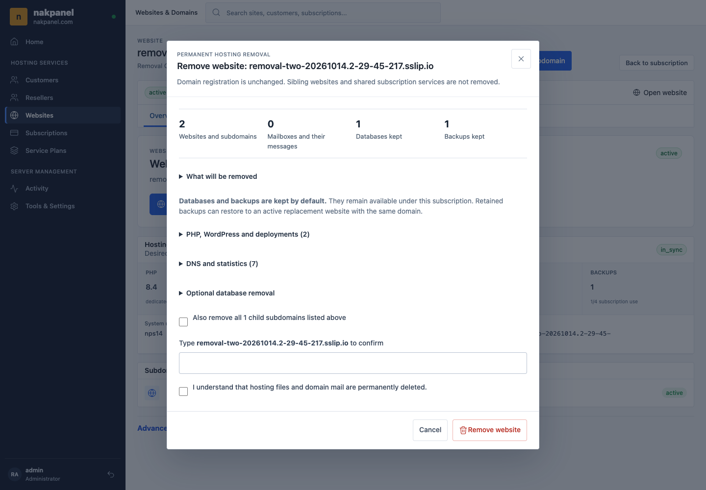
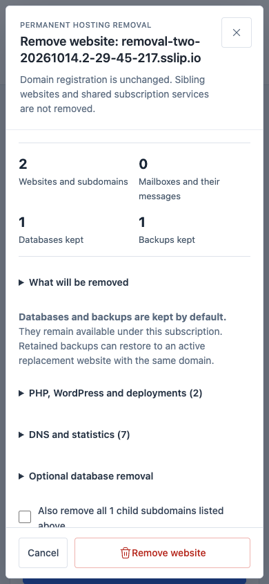

# Domain Removal Verification

Executed on October 14, 2026. Public target: `nakpanel.com`, Ubuntu 24.04 at
`2.29.45.217`. The public server was not reset or rebooted.

## Installed Release

- Panel, agent and panelctl: `29.0.0+45433e7`.
- Current release: `/opt/nakpanel/releases/45433e7`.
- Goose migration: `20261013000053`.
- All 15 pre-existing website IDs remained active: 1, 30-43.
- Existing customers, plans, websites, databases, mail, credentials and quotas
  were not deleted or increased for the test.

Source and all three Linux amd64 binaries were checksum-verified before
installation. Old workers were stopped before migration; the matching agent
started before the panel. Current-intent reconciliation 79 registered every
pre-existing positive site identity with root-owned `0600` records before QA.

Only fence-compatible releases may be used after removal begins. The older
unfenced binaries are retained for reference, not as a safe rollback target.

## Verification Gates

| Gate | Result |
| --- | --- |
| Full local Go suite, private PostgreSQL 17 | PASS |
| JavaScript tests | 104 PASS, 0 FAIL, 0 SKIP |
| Six affected Go race packages | PASS |
| Ubuntu PostgreSQL removal regressions | 72 PASS, 0 FAIL, 0 SKIP |
| Ubuntu agent removal/recovery regressions | 45 PASS, 0 FAIL, 0 SKIP |
| `go vet`, `task build`, diff and shell checks | PASS |
| Fresh single-VM `deployment-verify.sh` | PASS at `adf2271` |
| Native long-name configuration and rollback tests | PASS after the `45433e7` fix |
| Native removal acceptance after the nginx fix | PASS |
| Public independent removal passes | Both PASS |

The clean canonical gate installed the current full stack, then ran Phase 28,
the adversarial security suite, and Phases 29-34 before domain removal. Phase 29
tested upgrade rollback, reboot and fresh-target disaster recovery: 37,902
entries, one MariaDB database/user and zero convergence warnings. Its temporary
DR VM was removed. Only `nakpanel-lab` remains as a Nakpanel VM; unrelated VMs
were not changed. Historical Phase 1-27 UI assertions were not replayed as a
chain because some describe retired interfaces.

The final installer fix was checked by the full Go suite and targeted native
nginx/removal tests, not by claiming another complete fresh-stack run.

## Live Passes

The originally proposed `removal-*.nakpanel.com` roots could not belong to a
separate QA subscription: the existing `nakpanel.com` namespace belongs to
subscription 3. The guard correctly rejected that request without creating a
site. The operator explicitly approved these alternative isolated roots and
their new children:

- `removal-one-20261014.2-29-45-217.sslip.io`
- `removal-two-20261014.2-29-45-217.sslip.io`

| Resource | Pass 1 | Pass 2 |
| --- | --- | --- |
| QA customer / subscription | 20 / 13 | 21 / 14 |
| Preserved primary / sibling | 44 / 45 | 49 / 50 |
| Removed add-on / child | 46 / 48 | 51 / 53 |
| Default-retained database | 28 | 29 |
| Default-retained backup | 38 | 39 |

Each pass created its resources through authenticated panel routes. Primary
and panel-hostname removal previews were blocked; missing-CSRF removal was
rejected. Child-only removal preserved the parent website, authoritative DNS
and trusted ACME certificate. The child was recreated before the parent-tree
removal so descendant consent and cleanup were exercised separately.

Chrome checks at 1440x1000 and 390x844 verified unchecked optional database
deletion, initial Cancel focus, Escape handling, no document overflow, and
observed durable completion before redirect. Database credentials still worked
after removal; retained archives downloaded through the authenticated route
and passed tar inspection. Selected files, nginx routes and dedicated FPM
configuration disappeared; sibling files and the account survived.

Pass 2 additionally verified:

- Recreation under new ID 54 and explicit restore from retained backup 39.
- Native stale `create_site` RPC for removed ID 51 rejected before dispatch.
- A symlink fault confined to the approved new QA domain caused operation 5
  to fail without redirect, retaining its allocation.
- Repair, controlled panel/agent restart and manual same-scope retry completed
  operation 5 at revision 2; no public host reboot was performed.
- Another recreation, ID 55, and explicit deletion of the separately approved
  new database `removal_two_optional_20261014`. Its schema and principal were
  absent afterward; database 29 and backup 39 were untouched.
- A new linked QA client could log in, but cross-customer previews and removal
  history returned `404`. Scoped sibling reconciliation completed.

All six removal operations were completed at the final check, with no
incomplete or running/retryable/discarded removal jobs.

## Issues Found And Repaired

1. The rollout's first immediate agent ping raced systemd's socket creation.
   The healthy agent was verified before starting the panel; subsequent
   deployment and restart steps use bounded readiness checks.
2. The amd64 nginx default hash bucket rejected a valid long child hostname.
   A managed `512`-byte bucket and `4096` maximum-size drop-in now ships with
   fresh installation and upgrade. Native nginx reproduced the old failure,
   accepted a 253-character DNS name, and proved prior configuration/service
   preservation after config-test and reload faults. The failed child job then
   succeeded through its normal queued retry. [nginx server-name guidance](https://nginx.org/en/docs/http/server_names.html#optimization).
3. `/etc/nakpanel/version` contained a stale earlier commit. It was updated
   atomically under the deployment lock to match the active release.
4. Initial screenshots preceded asynchronous SVG painting. A delayed,
   non-destructive inspection confirmed the icons render; browser evidence now
   waits for glyph bounds rather than masking the issue with UI changes.

## Final Dependencies

- Trusted panel health and `test.nakpanel.com` HTTPS passed.
- Missing ACME challenge tokens returned `404`, while `.env`, `.git/config`
  and nested hidden paths returned `403`.
- Authoritative `nakpanel.com` A resolution and nginx, BIND and sshd
  configuration checks passed.
- Panel, agent, nginx, named, Stalwart, ProFTPD and SSH remained active.
- SMTP STARTTLS, IMAPS and explicit FTPS certificate verification passed for
  the configured endpoint `mail.nakpanel.com` after the controlled restart.
- The agent rejected a root-UID socket client and accepted the panel UID.

SMTP external-inbox delivery, authenticated FTPS data transfer and an SFTP
login were not re-exercised in this removal run; TLS/listener/configuration and
isolation checks must not be described as those stronger claims. No active
cache instance was introduced solely for QA. New remote Git onboarding was
not covered by the migrated legacy-hosted Git fixture. Herd PostgreSQL 18
compatibility was not claimed; the stalled shared local service was not
restarted, and verification used a disposable private cluster instead.

## Recovery Disposition

Databases 28/29, archives 38/39, the four QA primary/sibling websites and all
removal history were retained. Their owner subscriptions are 13/14. No original
database or backup was deleted; the only optional database deletion was the
new, explicitly approved QA database. The two QA customers remain active while
awaiting the operator's separate suspension choice; no existing customer is
part of that optional cleanup.

## Screenshots

The confirmed second-pass dialog, after icon painting:

