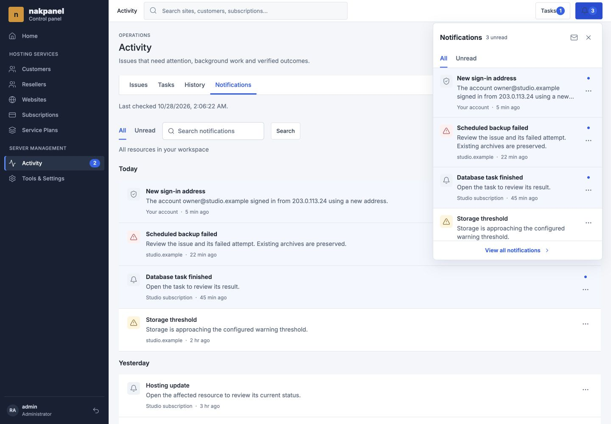
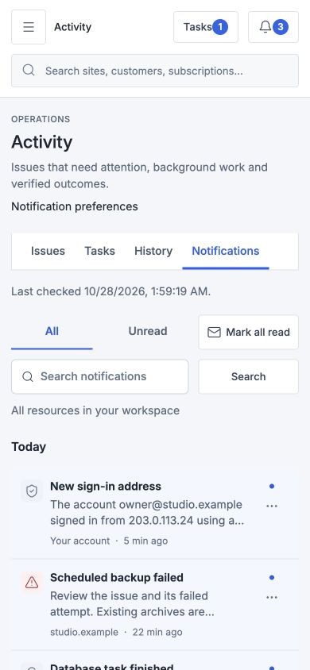
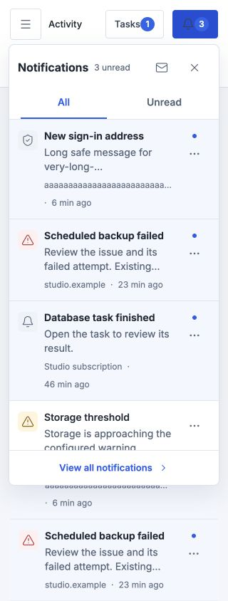
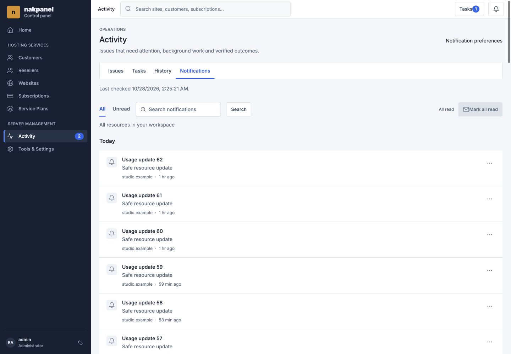

# Compact notifications: local verification

Date: 28 October 2026. Branch: `ricky/compact-notifications-design`.

## Scope

Implemented the approved compact bell preview, full inbox and safe standalone
details using Go/templ, embedded CSS and vanilla JavaScript. The existing
Operations poller, current authorization and personal receipt endpoints remain
the authority. No migration, notification producer, SMTP policy, retention,
installer or hosting runtime behavior changed.

This is local acceptance, not hosted acceptance. No connection to nakpanel.com,
deployment, live account mutation, external email, merge or push was performed.
Ubuntu 26.04 and the PHP 8.3/8.4/8.5 hosting contract remain unchanged. A later
hosted run requires explicit authorization and supported-OS preflight.

## Automated checks

- `go test ./... -count=1` with Operations PostgreSQL tests enabled using a
  dedicated loopback database, `nakpanel_operations_notifications_20261028`.
- `go vet ./...`.
- `task build`, including templ, embedded CSS and all three Go binaries.
- `node --test internal/control/web/static/*.test.cjs`: 98 tests passed after
  the final review fixes.
- `git diff --check` and syntax checking of the updated acceptance script.

The first full Go run hit the unchanged fake Multipass readiness test's 150ms
attempt timeout under parallel build load. That exact test passed three
consecutive focused reruns; subsequent full suites passed without weakening
timeouts or changing Multipass/installer code. No hosted VM was launched.

PostgreSQL cases exercised current admin/client/reseller visibility, account
notices, forged role denial, ownership transfer, resource filters, archived
authorized details, read-only GET semantics and safe-summary search. A hidden
unknown-kind body sentinel did not appear in list/detail/search. HTTP cases
covered authentication, invalid scope/ID, 404, safe failure, JSON/no-store and
viewer binding. Client tests covered one poller lifecycle, abort/stale identity,
keyed focus/scroll preservation, CSRF, duplicate-click suppression, failed
receipts, concurrent mark-all-read, and dialog-return focus.

## Browser pass A: desktop

Used the real rendered application with the loopback-only fictional Operations
fixture at 1440 x 1000. It has no agent, database writes or email delivery.

- Preview: five entries, 400px wide, maximum 560px high. The standard single
  notification was 270px high, not a mostly empty fixed-height panel.
- Full inbox: search for Storage returned one row while the preview kept five.
  Fifty notifications loaded as 25, then 50 with Show more; pagination ended.
- Standalone sign-in, linked issue and linked task opened their correct details.
  Exactly three personal-read POSTs were recorded, one per opened notification;
  the underlying issue stayed open. No unrelated mutation was recorded.
- Archive of the only fictional receipt produced a usable empty state and
  moved focus to the Notifications heading. Unread-only empty state and
  count/badge updates were verified.
- Dirty plan input survived opening the preview, polling and cancelling the
  existing unsaved-navigation confirmation. Cancel restored focus to View all
  notifications; Continue navigated to the inbox through the real router.
- A cancelled delayed detail and a 404 detail produced no read POST. Failed
  read receipt remained unread with Retry; successful retry cleared feedback
  and retained reachable focus. New arrival during Mark all read kept badge 1.
- Menu Escape closed the menu before its preview; outside click closed the
  preview. Detail Escape and Done restore a visible opener or the bell.

## Browser pass B: mobile and reflow

Reset fixture state independently and repeated actions at 390 x 844, then
320 x 844. Also tested a 720 x 500 CSS-pixel viewport, equivalent to the reflow
space of the desktop viewport at 200% zoom.

- Inbox filters, search and submit align in two rows; no spare oversized search
  row. All measured notification action targets were at least 44px. Summary
  text measured 14px; the document had zero horizontal overflow.
- Domain topbar notification access remains visible; its search is on a full
  second row instead of being squeezed beside actions.
- Repeated standalone/issue/task opening recorded one read POST per notification
  and left the issue open. Detail Shift+Tab wrapped inside the dialog. Escape
  from a hidden-preview opener returned to the visible bell.
- Repeated single-row archive, empty state, failed receipt/retry, cancelled slow
  detail, 404, mark-all-read race and independent inbox search. Slow cancellation
  and 404 each preserved three unread with no POST.
- Expired session showed sign-in guidance; a 503 showed interrupted-connection
  guidance. Both retained five last-known readable preview rows.
- Long email, IPv6 and a 1904-character safe message remained readable in the
  detail. Long resource context truncates only visually in the preview. At
  320px, its message region was 180px wide and 113px high after correction.
- Long detail footer stayed within the dialog: bottom 831px inside dialog bottom
  832px; Done was 44px high and fully reachable. Menus remained within viewport.
- At 720 x 500, preview height constrained to 426px, footer bottom 487px; no
  horizontal overflow or clipped footer. Native zoom itself was not verified:
  the in-app browser offers viewport, not zoom, and the zoom shortcut did not
  change its rendering metrics.
- Client, reseller and administrator support presentations were checked.
  Subscription scope used subscription 42; support scope used customer 10 and
  retained the support-prefixed inbox link. Actual authorization is tested in
  PostgreSQL/handler tests, not inferred from fictional browser data.
- Final browser console check returned no warning/error entries.

## Regressions found and fixed

1. A templ icon call appeared as literal footer text. SSR regression now rejects
   leaked `@icon(` text; the footer renders the bundled icon correctly.
2. Cancelling a nested navigation confirmation closed its parent preview and
   lost focus. Outside-click/Escape coordination now respects open dialogs.
3. Mobile toolbar Search occupied an extra row, and global button selectors
   overrode 44px targets. Scoped notification rules fix both.
4. Domain mobile CSS hid topbar notifications. Scoped layout restores access
   without squeezing global search.
5. Successful read updates retained a stale screen-reader Unread span. The
   keyed renderer now hides that announcement.
6. Poll failures discarded the HTTP status. Expired-session and offline feedback
   now remain distinct.
7. Detail close tried to focus a row inside a hidden preview. Both close paths
   now select a visible opener or bell.
8. Long resource labels expanded compact rows, and a sticky footer offset clipped
   long-message actions. Context ellipsis and a contained footer correct them.

The pre-fix screenshots are retained as regression evidence and are explicitly
named `before`. The updated acceptance script includes the corresponding
navigation/detail-focus cases; it was syntax-checked, not externally executed.

## Final review and fix pass

A fresh-context read-only review found no critical issue, two important
pagination defects and one minor accessible-label refinement. Both important
findings were addressed in one test-first fix pass:

- Mark all read after Show more previously updated the badge but left loaded
  rows stale. The existing poller now refreshes the loaded notification window,
  using bounded keyset pages of at most 200 entries per request. It uses current
  server read states and counts rather than marking every client row read.
- Pagination now captures the mount, authenticated scope, view and owning DOM
  nodes. Navigation, unmount and pagehide abort it. Success and error callbacks
  also reject stale contexts, including when a transport ignores cancellation.

New Node tests first failed, then passed. They integrate the receipt coordinator,
poller and paged window for All and Unread with 250 entries and a concurrent
arrival. The stale-request test covers duplicate clicks, cancellation, a late
success, a late error and a new current request.

The real local UI reproduced 47 unread rows remaining after the badge changed to
All read. After the fix, All retained 50 loaded rows with zero unread; Unread
loaded 47 then cleared to All caught up. A delayed Show more followed by routed
scope navigation retained 25 current rows without old-scope content. The browser
cases were added to the acceptance script and manually exercised through the
approved browser.

Deferred minor: the mark-all accessible names do not yet name the specific
subscription/customer/workspace; the visible scope context is present. This is
not an authorization or receipt-scope change.

## Decisions and remaining gates

- Added one bounded five-entry SSR read because the existing quick payload
  contains tasks, not inbox entries. This avoids a fabricated empty first render
  at the cost of one additional bounded query per page render.
- Actual native 200% zoom remains a manual gate in a zoom-capable browser.
  Equivalent reflow is evidence for layout, not a claim of native zoom support.
- Hosted Ubuntu 26.04, live SMTP and production browser checks are not established
  by these local results. Integration and deployment remain separate decisions.
